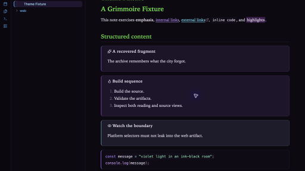
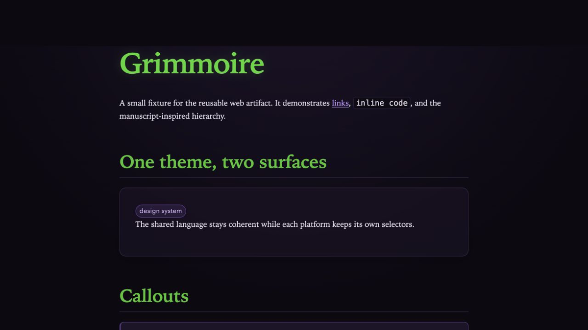

# Grimmoire

Grimmoire is a dark, neon-arcane design system for Obsidian and the web. It pairs an ink-black workspace with restrained violet light, cyan details, manuscript-inspired headings, and constellation-like accents.

The repository produces two artifacts:

- `theme.css` and `manifest.json`, an installable Obsidian theme.
- `dist/web/grimmoire-web.css`, reusable CSS for ordinary websites.

## Preview

### Obsidian



### Web



## Install in Obsidian

1. Download `manifest.json` and `theme.css` from the same release.
2. Create `<your-vault>/.obsidian/themes/Grimmoire/`.
3. Place both files in that folder.
4. In **Settings → Appearance**, choose the dark base color scheme and select **Grimmoire**.

The theme contains no remote fonts, scripts, or images. It targets Obsidian 1.13 or newer.

## Use on the web

Download `grimmoire-web.css` from a release and load it before your site-specific CSS:

```html
<link rel="stylesheet" href="/assets/css/grimmoire-web.css">
<link rel="stylesheet" href="/assets/css/site.css">
```

The artifact styles document typography and exposes reusable `.grimmoire-surface`, `.grimmoire-tag`, and `.grimmoire-callout` classes. Site navigation, layouts, and application-specific components remain the consuming site's responsibility. The example at `examples/web/index.html` is a small visual fixture.

## Custom callouts

Grimmoire adds `lore` (and its alias `arcana`), `ritual`, and `omen` callouts:

```markdown
> [!lore] A recovered fragment
> Notes about the history of the world.

> [!ritual] Required steps
> A process, recipe, or repeatable practice.

> [!omen] Watch for this
> A clue, warning, or open question.
```

Add `grimmoire-no-glow` under **Settings → Appearance → CSS classes** to remove decorative glow while retaining the palette. Both targets also honor `prefers-reduced-motion`.

## Develop and validate

Node 20 or newer is required; there are no runtime or development dependencies.

```sh
npm run build
npm run validate
npm run package-release
```

Edit files under `src/`. The build writes the required root-level Obsidian artifact, stages Obsidian files under `dist/obsidian/`, and writes readable and minified web artifacts under `dist/web/`. Generated artifacts are committed so they can be installed or consumed directly.

Release automation should set `GRIMMOIRE_SOURCE_COMMIT` to the release commit before building so the web artifact banner is auditable. Ordinary local builds use `unreleased` and remain deterministic.

```text
src/shared/    design tokens, typography, and effects
src/obsidian/  Obsidian semantic mappings and selectors
src/web/       browser document defaults and reusable components
```

Release tags must exactly match the version in `manifest.json`. Attach `manifest.json`, `theme.css`, `grimmoire-web.css`, and optionally the minified web artifact to the GitHub release.

## Design tokens

| Role | Color |
| --- | --- |
| Void | `#0d0912` |
| Panel | `#171020` |
| Raised surface | `#20172b` |
| Violet | `#a970ff` |
| Magenta | `#d45cff` |
| Cyan | `#55e6ff` |
| Main text | `#e5deed` |
| Muted text | `#a398af` |

## Screenshots and support

Release screenshots are captured from the public fixtures in `examples/`; see `screenshots/README.md` for dimensions and recapture guidance. Compatibility reports should include the Obsidian or browser version, operating system, relevant plugins or extensions, and reproduction steps. Support is best-effort and does not imply compatibility with every third-party Obsidian plugin.

## License

Grimmoire is available under the [MIT License](LICENSE).
